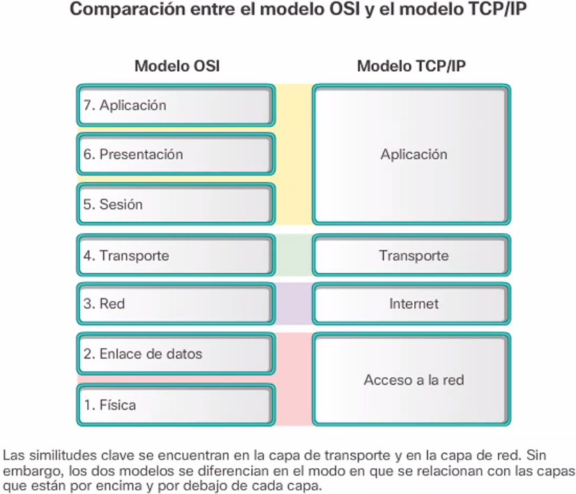
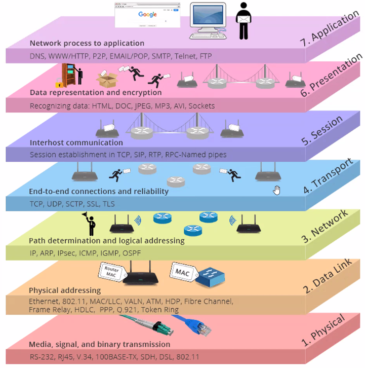

# Redes de datos

Una red de datos es un conjunto de dispositivos, interfaces de comunicación, medios de transmisión y protocolos que permiten intercambiar información entre dos o más equipos.

Los dispositivos pueden ser computadoras, teléfonos, servidores, impresoras, switches, routers y otros sistemas conectados por medios cableados o inalámbricos. Para que puedan comunicarse, deben utilizar tecnologías y protocolos compatibles.

Objetivos de una red de datos
- Compartir recursos: permitir el acceso a archivos, impresoras, aplicaciones, almacenamiento y conexiones a Internet.
- Intercambiar información: facilitar la comunicación entre usuarios, aplicaciones y sistemas.
- Mejorar la disponibilidad: diseñar la infraestructura para reducir interrupciones y, cuando sea necesario, incorporar redundancia.
- Ofrecer un rendimiento adecuado: transportar los datos con capacidad, latencia y pérdida de paquetes compatibles con las necesidades de los servicios.
- Optimizar costos y administración: centralizar servicios y facilitar la supervisión, el mantenimiento y el crecimiento de la infraestructura.
- Proteger la información: aplicar controles de acceso, segmentación, cifrado y otras medidas de seguridad.

> Una red no garantiza por sí sola la disponibilidad, la seguridad ni una alta velocidad. Esas propiedades dependen del diseño, los equipos, la configuración, los protocolos y la operación de la infraestructura.

Elementos de la comunicación en redes: 

| `Elemento` | `Descripcion` |
|---|---|
| **Mensaje** | Datos que se desean transmitir: texto, archivos, audio, video, solicitudes, respuestas, entre otros. |
| **Protocolo** | Conjunto de reglas que especifican la manera en cómo los mensajes se envían a través de una red  |
| **Emisor** | Elemento que envía el mensaje |
| **Receptor** | Elemento que recibe el mensaje  |
| **Medio** | Medio por el que viaja la señal: cobre, fibra óptica o espacio libre mediante ondas electromagnéticas.  |

## Ejemplos de mensajes

* **Programas de mensajeria** (Como whastapp)
* **Navegador web** (Donde se envia una peticion a un servidor web)
* **Servicios de streaming**

El contenido suele originarse en una aplicación, pero eso no significa que todo el mensaje de red se genere exclusivamente en la capa 7 del modelo `OSI`. Al prepararse para la transmisión, los datos atraviesan distintas capas, que agregan la información de control necesaria para transportarlos.

## Ejemplos de protocolos

* El Protocolo de transferencia de hipertexto (**HTTP**)
* Protocolo para transferencia simple de correo (**SMTP**)

Estos protocolos determinan el formato del mensaje, y tambien, informacion del estado. Realizado todo en la capa 7.

## Modelos de capas

El modelo de interconexión de sistemas abiertos, conocido como modelo `OSI`, es un modelo de referencia para los **protocolos de la red**. Es un estándar que tiene por objetivo conseguir interconectar sistemas de procedencia distinta para que estos pudieran intercambiar información sin ningún tipo de impedimentos

El modelo OSI se usa como referencia 

| Capa | Nombre | Función principal | Ejemplos o conceptos asociados |
|---:|---|---|---|
| **7** | Aplicación | Ofrece servicios de red a las aplicaciones. | HTTP, DNS, SMTP. |
| **6** | Presentación | Representa, transforma o codifica los datos; contempla tareas como compresión y cifrado dentro del modelo. | Formatos de datos, codificación, cifrado. |
| **5** | Sesión | Organiza y administra diálogos o sesiones entre aplicaciones. | Establecimiento, mantenimiento y cierre de sesiones conceptuales. |
| **4** | Transporte | Permite la comunicación lógica entre procesos y puede aportar segmentación, multiplexación, control de flujo y confiabilidad. | TCP, UDP. |
| **3** | Red | Proporciona direccionamiento lógico y encaminamiento entre redes. | IP, routers. |
| **2** | Enlace de datos | Organiza la transmisión en tramas dentro de un enlace, utiliza direcciones de enlace cuando corresponde y permite detectar ciertos errores. | Ethernet, Wi-Fi, direcciones MAC, switches. |
| **1** | Física | Transmite los bits como señales a través de un medio físico. | Cobre, fibra óptica, radio, conectores y señalización. |

## Modelo TCP/IP

El modelo TCP/IP describe la arquitectura de protocolos utilizada en Internet. Una representación habitual tiene cuatro capas:

| Modelo TCP/IP | Función | Correspondencia aproximada con OSI |
|---|---|---|
| **Aplicación** | Protocolos utilizados por las aplicaciones y formatos de comunicación. | Capas 5, 6 y 7. |
| **Transporte** | Comunicación entre procesos de los equipos de origen y destino. | Capa 4. |
| **Internet** | Direccionamiento IP y encaminamiento de paquetes entre redes. | Capa 3. |
| **Acceso a la red** | Funciones de enlace y transmisión sobre el medio. | Capas 1 y 2. |

# Dispositivos

## Hosts o equipos finales

Un host es un dispositivo conectado a una red que puede originar o recibir comunicaciones. Puede ejecutar aplicaciones, ofrecer servicios o cumplir ambas funciones.

Dispositivos finales

- Computadoras de escritorio y notebooks.
- Teléfonos y tablets.
- Impresoras de red.
- Cámaras IP.
- Servidores físicos o virtuales.
- Dispositivos IoT, como sensores y controladores.

## Servidores

Un servidor es un sistema que ofrece servicios o recursos a otros sistemas, llamados clientes. El término describe principalmente una función, no necesariamente un tipo particular de hardware.

Ejemplos:
- Servidor `web`: entrega contenido o aplicaciones web.
- Servidor `DNS`: responde consultas de nombres.
- Servidor de `archivos`: ofrece almacenamiento compartido.
- Servidor de `bases de datos`: procesa consultas y administra datos.
- Servidor de `autenticación`: participa en la verificación de identidades y el control de acceso.

Un mismo equipo puede ejecutar varios servicios, aunque en entornos productivos suelen separarse según los requisitos de seguridad, rendimiento y disponibilidad.

### Dispositivos de red (NIC)

La NIC (Network Interface Card o Controller) es el componente que permite a un dispositivo conectarse a una red. Puede estar integrada en la placa madre, instalarse como una tarjeta o implementarse mediante hardware virtual.

Una NIC puede ser:
- `Ethernet`: utiliza un medio cableado, normalmente par trenzado de cobre o fibra, según el tipo de interfaz.
- `Wi-Fi`: se comunica mediante ondas de radio.
- `Virtual`: permite que una máquina virtual o un sistema operativo utilice una interfaz lógica conectada a una red virtual.

Bluetooth también es una tecnología inalámbrica, pero no debe considerarse equivalente a Wi-Fi: se utiliza para otros perfiles y escenarios de comunicación, frecuentemente de corto alcance.

### SWITCH 

Un switch Ethernet conecta dispositivos dentro de una red local. Aprende direcciones MAC observando las tramas recibidas y construye una tabla que asocia direcciones MAC con puertos.

Cuando recibe una trama, utiliza esa tabla para decidir por qué puerto reenviarla. Si no conoce la dirección MAC de destino, normalmente inunda la trama por los demás puertos de la VLAN correspondiente, excepto por el puerto de entrada. Las tramas de broadcast también se distribuyen dentro del dominio de broadcast correspondiente.

Funciones y conceptos importantes:
- Conecta múltiples dispositivos dentro de una LAN.
- Reduce la necesidad de enviar todas las tramas a todos los puertos, a diferencia de un hub.
- Cada puerto de switch suele constituir un dominio de colisión independiente en Ethernet conmutado full-duplex.
- Las VLAN permiten segmentar lógicamente una infraestructura conmutada.
- Un switch de capa 3 también puede realizar funciones de encaminamiento IP.

Ejemplo: una computadora y una impresora conectadas al mismo switch pueden comunicarse dentro de la LAN si el direccionamiento y la configuración son compatibles.

### Router

Un router conecta redes `IP` diferentes y reenvía paquetes según su dirección IP de destino y su tabla de enrutamiento. La tabla puede incluir rutas conectadas directamente, rutas estáticas y rutas aprendidas mediante protocolos de enrutamiento.

Funciones habituales:
- Interconectar distintas redes IP.
- Elegir el siguiente salto de un paquete según la tabla de rutas.
- Actuar como puerta de enlace predeterminada de los hosts.
- En muchos equipos domésticos, proporcionar además NAT, DHCP y funciones de firewall.
Un router no se limita a conectar segmentos físicos: su función central es interconectar redes lógicas. Un mismo enlace físico puede transportar varias redes lógicas mediante tecnologías como VLAN.

Ejemplo: una computadora con IP `192.168.1.20/24` puede enviar tráfico a un servidor de otra red, como `10.20.0.15`, a través de su puerta de enlace si existe una ruta válida.

### Medios

Lo entendemos como el medio físico por donde se transporta la información. Algunos ejemplos son:

| Medio o componente | Descripción |
|---|---|
| **Par trenzado de cobre** | Cable formado por pares de conductores trenzados, utilizado en Ethernet. Puede emplear conectores 8P8C, comúnmente llamados RJ-45. |
| **Cable coaxial** | Conductor central rodeado por aislamiento y una malla conductora. Se usa en determinados sistemas de telecomunicaciones y redes. |
| **Fibra óptica** | Transporta señales luminosas; se utiliza en enlaces de alta capacidad y larga distancia. |
| **Conector 8P8C** | Conector modular de ocho posiciones y ocho contactos, conocido popularmente como RJ-45 en Ethernet sobre par trenzado. |
| **Conector BNC** | Conector utilizado en ciertos cables coaxiales y equipos de radiofrecuencia o instrumentación. No es un medio de transmisión por sí mismo. |

### Otros dispositivos

`Repetidor`: Aumenta el alcance de una conexión física, recibiendo las señales y retransmitiendolas, para evitar su degradación, a través del medio de transmisión, lográndose un alcance mayor

`Concentrador`: Funciona como un repetidor pero permite la interconexión de múltiples nodos. (Tambien se llama `concentrador`)

---

# Tipos de redes

Las redes pueden clasificarse por el área que cubren, la tecnología utilizada, su arquitectura o su propósito. Las categorías PAN, LAN, MAN y WAN describen principalmente el alcance geográfico aproximado; sus límites no son universales y pueden variar según el contexto.

## PAN y WPAN

Una `PAN` (Personal Area Network) es una red de área personal que conecta dispositivos alrededor de una persona o de un espacio muy reducido.

Una `WPAN` (Wireless Personal Area Network) es su variante **inalámbrica**.

Ejemplos:
- Un teléfono conectado a auriculares mediante Bluetooth.
- Un equipo conectado a un dispositivo personal por una tecnología inalámbrica de corto alcance.
- La conexión entre dispositivos personales que intercambian datos.

USB es una conexión cableada entre dispositivos, pero no siempre se clasifica como una red `PAN` en el mismo sentido que una red de comunicaciones. La clasificación depende de la definición utilizada por el material de referencia.

## LAN

Una `LAN` (Local Area Network) es una red de área local que conecta dispositivos dentro de un espacio limitado, como una vivienda, una oficina, un laboratorio o un edificio.

Características habituales:
- Administración generalmente local.
- Alta capacidad en comparación con muchas conexiones de larga distancia.
- Uso frecuente de Ethernet y Wi-Fi.
- Posibilidad de dividir la red en varias subredes IP y VLAN.

Ejemplo: una oficina donde computadoras, impresoras y servidores se conectan a switches y puntos de acceso.

No se define una LAN simplemente por tener dos o más dispositivos. Lo determinante es el alcance y la arquitectura de red local, no solo el número de equipos.

## MAN

Una `MAN` (Metropolitan Area Network) es una red que interconecta redes o ubicaciones dentro de un área metropolitana o una región urbana extensa.

Ejemplos:
- Una organización que conecta edificios ubicados en distintas zonas de una ciudad.
- Una infraestructura metropolitana de fibra óptica.
- Una red de un proveedor que conecta distintos puntos de presencia de una ciudad.

Las `MAN` no han desaparecido por el uso de VPN. Una VPN es una tecnología que crea un canal lógico protegido sobre una red subyacente; puede utilizar Internet, una MAN u otra infraestructura. Por lo tanto, `MAN` y `VPN` no son categorías equivalentes ni tecnologías que se sustituyan directamente.

## WAN

Una `WAN` (Wide Area Network) es una red de área amplia que conecta redes o ubicaciones separadas por distancias grandes, por ejemplo, entre ciudades, provincias o países.

Ejemplos:
- Una empresa que conecta sucursales en distintas provincias.
- La infraestructura de un proveedor de telecomunicaciones.
- Internet, que interconecta una enorme cantidad de redes independientes y puede describirse como una red de redes.

Una `WAN` puede utilizar enlaces de fibra, circuitos de operadores, radioenlaces, redes móviles, VPN y otras tecnologías. La cantidad de dispositivos que puede conectar depende de su diseño y de las tecnologías empleadas; no es literalmente ilimitada.

---

# Nodos de red

Un nodo es un punto de una red que puede originar, recibir o reenviar información. Según el contexto, puede ser un host, una interfaz de red, un switch, un router, un punto de acceso u otro dispositivo conectado.

No todos los nodos cumplen la misma función:
- Nodos finales: originan o reciben datos para aplicaciones, como una computadora o un servidor.
- Nodos intermediarios: reenvían o procesan tráfico, como switches y routers.

En documentación técnica conviene especificar si se habla de un dispositivo físico, una interfaz o un punto lógico, ya que la palabra nodo puede referirse a distintos elementos según el contexto.

---

# Topologias de RED

La topología de una red es la configuración o relación de los dispositivos de red y las interconexiones entre ellos.

Las topologías definen la estructura de una red, pueden verse en el **nivel físico** y el **nivel lógico**.

La **topologia fisica** es una disposición real de medios, así también la configuración de nodos y las conexiones físicas entre ellos. La representación de cómo se usan los medios para interconectar los dispositivos es la topología física.

Por lo tanto la topología física describe cómo los nodos se conectan entre sí.

La **topología lógica** de una red es la forma en que los hosts se comunican a través de la red.

Los dos tipos más comunes son broadcast y transmisión de tokens, aunque la topología de broadcast es lo que se usa actualmente.

La topología broadcast simplemente significa que cada host envía sus datos hacia todos los demás hosts del medio de red. No existe un orden que las estaciones deban seguir para utilizar la red. 

Es por orden de llegada, es como funciona **Ethernet**.

## Topologia estrella

Los **nodos** se conectan a un conmutador, cada host puede acceder al resto a través de él. Esta arquitectura es la más sencilla, fuera de las redes de punto a punto.

Caracteristicas:

* Se pueden agregar o eliminar nodos de forma sencilla sin necesidad de alterar la infraestructura.
* Está limitada a la cantidad de conexiones que permite el switch.
* La caida de un nodo no supone un problema para la comunicación con el resto de los nodos.

## Topologia jerárquica

La red en árbol es una topología de red en la que los **nodos** están colocados en forma de árbol.

Desde una visión topológica, es parecida a una serie de redes en estrella interconectadas salvo en que no tiene un concentrador central.
En cambio, tiene un nodo de enlace troncal, generalmente ocupado por un hub o switch, desde el que se ramifican los demás nodos.

Es una variación de la red en bus, el fallo de un nodo o switch no implica una interrupción en las comunicaciones.

Caracteristicas: 

* La topología de árbol reduce el tráfico de red.
* Los dispositivos en las otras jerarquías de la red no se ven perjudicados si se daña alguno de los dispositivos de una de las ramas de la red.
* Altamente flexible.
* Si se cae el segmento principal todo el segmento también cae.
* Fácil detección de errores.

## Topologia en malla

En una red de malla los **dispositivos** (o nodos) están conectados entre sí, ramificando otros dispositivos o nodos. Estas redes se configuran para enrutar eficazmente los datos entre dispositivos y clientes. Ayudan a las organizaciones a proporcionar una conexión consistente en todo un espacio físico.

Es una configuración de red donde todos los nodos cooperan para distribuir los datos entre sí

Caracteristicas:

* Resistente a problemas.
* No hay problemas de tráfico.
* Fácil escalabilidad.
* Configuración inicial complicada.
* Mayor carga de trabajo.
* Es costosa.
* Mayor consumo de energía.

--- 

# Backbone

El backbone es la parte de una infraestructura que interconecta segmentos, redes o capas de distribución y transporta una proporción importante del tráfico. Suele diseñarse para ofrecer capacidad, disponibilidad y escalabilidad adecuadas a la carga agregada de la red.

Puede conectar, por ejemplo:
- Switches de acceso con switches de distribución.
- Redes de distintos edificios de una organización.
- Centros de datos con redes corporativas.
- La red interna con routers que conectan a otros sitios o proveedores.

El backbone no es necesariamente un único cable ni un único dispositivo. Puede estar compuesto por varios enlaces, switches, routers y rutas redundantes.

## En serie

Cada segmento de red (switch) se comunica con el otro conectándose en serie. Las conexiones que transportan la información entre cada segmento es el backbone.

## Distribuido

La red troncal distribuida utiliza un diseño jerárquico de la red, donde varios dispositivos intermedios están conectados a dispositivos de conectividad únicos o múltiples.

Estos dispositivos de conectividad central pueden ser conmutadores y enrutadores.

---

# Ejemplo integrador

Ejemplo integrador: una pequeña red de oficina
Una oficina dispone de computadoras, una impresora de red, un servidor y acceso a Internet.

1. Las computadoras y la impresora se conectan a un switch mediante Ethernet o a un punto de acceso mediante Wi-Fi.
2. Cada host utiliza una dirección IP y una máscara o prefijo que determinan su subred.
3. Para comunicarse con un dispositivo de la misma subred, el host envía el tráfico por la interfaz local; en IPv4 suele utilizar ARP para conocer la dirección MAC correspondiente al siguiente salto local.
4. Para comunicarse con una dirección de otra red, el host envía el paquete a su puerta de enlace predeterminada, normalmente la interfaz LAN de un router.
5. El router consulta su tabla de enrutamiento y reenvía el paquete hacia el siguiente salto adecuado.
6. Un servidor puede ofrecer servicios como archivos, aplicaciones o bases de datos, según la configuración.
7. Un firewall puede filtrar las comunicaciones permitidas y reducir la exposición de los sistemas.

Este ejemplo muestra cómo colaboran los hosts, las NIC, los switches, los routers, los medios de transmisión y los protocolos. La comunicación correcta depende tanto de la conectividad física como del direccionamiento y la configuración lógica.